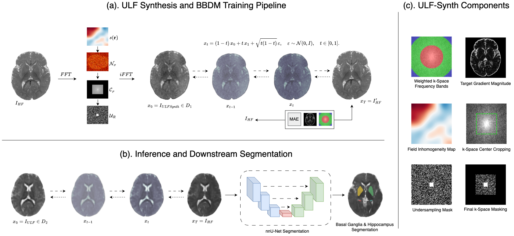

<h1 align="center">
  <a href="https://arxiv.org/abs/2605.24625" style="text-decoration:none; color:inherit;">ULF-Synth: Physics-Guided Ultra-Low-Field MRI Enhancement for Pediatric Neuroimaging</a>
</h1>

<p align="center">
  <a href="https://arxiv.org/abs/2605.24625"></a>
  <a href="https://pypi.org/project/ulfsynth/"></a>
  <a href="https://opensource.org/licenses/MIT"></a>
  <a href="https://www.python.org/"></a>
</p>

<p align="center">
  <a href="#abstract">Abstract</a> &bull;
  <a href="#qualitative-results">Qualitative Results</a> &bull;
  <a href="#installation">Installation</a> &bull;
  <a href="#python-api">Python API</a> &bull;
  <a href="#cli">CLI</a> &bull;
  <a href="#citation">Citation</a>
</p>

<p align="center">
  
</p>

## Abstract

Ultra-low-field (ULF) MRI enables portable and accessible neuroimaging, but suffers from low signal-to-noise ratio and limited spatial resolution relative to high-field (HF) systems. Acquiring paired ULF–HF data for supervised enhancement is often infeasible, particularly in resource-limited settings. We introduce **ULF-Synth**, a framework combining: (i) acquisition-based synthesis of realistic ULF images from HF volumes for large-scale paired training, and (ii) a spatial-frequency domain objective that prioritizes recovery of high-frequency anatomical detail. The formulation is architecture-agnostic, consistently improving structural similarity and perceptual fidelity across encoder-decoder, adversarial, and diffusion-based translation models. Trained exclusively on synthetic data, our models generalize to real 64 mT ULF acquisitions, improving multiclass brain segmentation and achieving higher radiologist preference and diagnostic acceptability in a blinded reader study.

---

## Qualitative Results

<p align="center">
  
</p>

---

## Installation

```bash
pip install ulfsynth
```

Or install from source:

```bash
git clone https://github.com/toufiqmusah/ULF-Synth.git
cd ULF-Synth
pip install -e .
```

---

## Python API

### Enhancement

```python
from ulfsynth.enhance import enhance_file, enhance_folder

# Single file (CPU)
enhance_file("ulf_scan.nii.gz", "enhanced.nii.gz", device="cpu")

# Batch folder (GPU)
enhance_folder("ulf_scans/", "enhanced_scans/", device="cuda")
```

### Simulation

```python
from ulfsynth.simulate import simulate_ulf, simulate_file, simulate_folder

# Get the ULF volume + metadata
ulf_vol, affine, header, params = simulate_ulf("hf_scan.nii.gz", seed=42)

# Save directly
params = simulate_file("hf_scan.nii.gz", "ulf_scan.nii.gz", seed=42)

# Process a folder
results = simulate_folder("hf_scans/", "ulf_scans/", seed=42)
```

---

## CLI

The `ulfsynth` package provides command-line tools for synthesis and enhancement:

### Simulation

```bash
# Single volume
ulfsynth simulate input.nii.gz output.nii.gz

# Folder of NIfTI files
ulfsynth simulate /path/to/hf/scans/ /path/to/ulf/scans/

# Reproducible seed
ulfsynth simulate input.nii.gz output.nii.gz --seed 42
```

### Enhancement

```bash
# Single volume (CPU)
ulfsynth enhance input.nii.gz output.nii.gz --device cpu

# Folder of NIfTI files (GPU)
ulfsynth enhance /path/to/ulf/scans/ /path/to/enhanced/scans/ --device cuda
```

---

## Roadmap

- [x] Physics-guided ULF synthesis pipeline
- [x] Pre-trained enhancement weights — ULF→HF restoration models
- [x] Python package — `pip install ulfsynth`
- [ ] Docker image — zero-config containerized pipeline

---

## Citation

```bibtex
@article{musah2026ulfsynth,
  title        = {ULF-Synth: Physics-Guided Ultra-Low-Field MRI Enhancement for Pediatric Neuroimaging},
  author       = {Toufiq Musah and Salvatore Calcagno and Federica Proietto Salanitri and Xiaomeng Li and Maruf Adewole and Marawan Elbatel},
  year         = {2026},
  journal      = {arXiv preprint arXiv:2605.24625},
  eprint       = {2605.24625},
  archivePrefix = {arXiv},
  url          = {https://arxiv.org/abs/2605.24625}
}
```

---

## License

[MIT](LICENSE)
